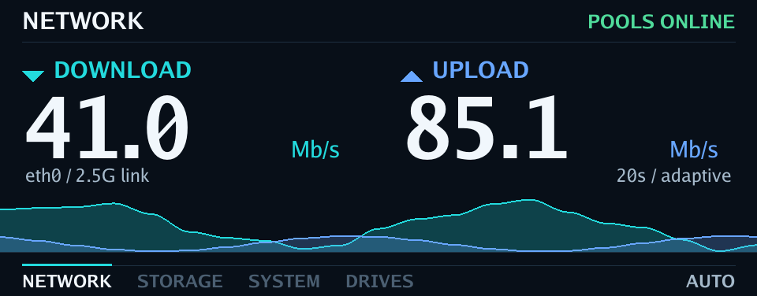

# WTR Display

Readable, rotating or fixed TrueNAS views for the AOOSTAR WTR MAX front panel.
Native Go rendering, no browser or web server, and differential RGB565 transfers.



*Rendered by the application at 960 × 376 with synthetic sample data. The tour
uses shorter page dwell times; hardware animation speed depends on the selected
profile and USB transfer cost.*

[Download v1.11.0](https://github.com/lennarkivistik/aoostar-wtr-max-truenas-display/releases/tag/v1.11.0)
· [Still previews](docs/previews)

## Views

- **Network:** large download/upload rates and cyan/blue filled waves.
- **Storage:** one pool per page, usable capacity, available space and actual ZFS health.
- **System:** CPU load and temperature, available RAM and measured ZFS ARC usage.
- **Drives:** six SATA and five NVMe bays, occupancy and available kernel temperatures.

Rotation defaults to 10 seconds per page. Every non-boot pool gets a storage
page. Fixed mode keeps live measurements on one selected view. Critical faults
interrupt either mode; informational notifications cannot cover them. Missing
readings show as unknown. Occupied bays do not imply SMART health.

## Build and preview

Requires Go 1.24 or newer. The Linux runtime needs ZFS tools and access to the
AOOSTAR display (`0416:90A1`, usually `/dev/ttyACM0`, 960 x 376 pixels).

```sh
./build.sh linux amd64 v1.11.0

# Works on a development computer, without a display or TrueNAS.
go run . --preview build/previews
```

Previews contain deterministic **demo data**. `--screenshot` captures the last
successfully transmitted frame from a running instance.

## Choose a view

```sh
# Rotate through network, each storage pool, system and drives.
./wtr-display --iface eth0

# Keep one live view on screen. The wave still animates.
./wtr-display --iface eth0 --view network

# Pin one pool, with no automatic page changes.
./wtr-display --iface eth0 --view storage --pool tank

# Choose the rotation and dwell time.
./wtr-display --iface eth0 --views network,system,storage --view-duration 12s

# A quieter network view without animation.
./wtr-display --iface eth0 --view network --wave-style off
```

`--view` and `--views` are mutually exclusive. A fixed storage view without
`--pool` selects the first non-boot pool. The selected pool and page count remain
visible; use `--pool` to choose another. A missing requested pool displays an
unavailable message instead of silently selecting a different pool.

## Appearance and resource use

```sh
./wtr-display --iface eth0 --profile eco
./wtr-display --iface eth0 --profile smooth --wave-history 30s
./wtr-display --iface eth0 --view network --wave-scale link
```

| Option | Default | Behavior |
|---|---|---|
| `--view NAME` | unset | Pin `network`, `storage`, `system` or `drives` |
| `--views LIST` | `network,storage,system,drives` | Ordered rotating views |
| `--view-duration` | `10s` | Page dwell, 3s–1h |
| `--pool NAME` | unset | Select a storage pool |
| `--profile` | `balanced` | `eco` up to 1 FPS, `balanced` up to 4, `smooth` up to 8 |
| `--wave-style` | `filled` | `filled`, `line` or `off` |
| `--wave-history` | `20s` | Visible history, 5s–5m |
| `--wave-scale` | `adaptive` | Adaptive scale or fixed link capacity |
| `--wave-fps` | profile-dependent | Requested wave FPS, 1–10 |
| `--frame-interval` | profile-dependent | Requested interval, 100ms–1h; overrides FPS |
| `--samples` | `20` | Legacy history alias in seconds; `--wave-history` wins |
| `--preview DIR` | unset | Write demo PNGs without opening hardware |

Manual timing requests remain bounded by CPU load and observed transfer cost.
Low traffic also reduces animation cadence. A flat, settled wave sleeps; static
views skip rendering and conversion when visible values have not changed.
Critical status changes and page rotation do not wait for long manual intervals.

The sampler reads network counters once per second; intermediate wave frames
interpolate history, not additional measurements. Adaptive scale is labelled
and must not be interpreted as percentage of link capacity. If link speed is
unavailable, link scaling falls back to adaptive scaling.

## Night schedule

```sh
./wtr-display --iface eth0 --off-time 23:00 --on-time 10:00
./wtr-display --iface eth0 --night-mode on
./wtr-display --iface eth0 --auto --night-mode off
```

Profiles always manage resource use. `--auto` retains the previous default
23:00–10:00 night schedule for existing startup scripts. `--night-mode off`
overrides it; `--night-mode on` enables the default schedule without `--auto`.
Explicit times override defaults. Both times must be valid, different HH:MM
values. Scheduling uses the NAS's local timezone. Network history resets on wake.

## Notifications and controls

```sh
./wtr-display --notify 'Backup complete'
./wtr-display --notify 'Maintenance starting' --notify-type warning --notify-duration 20
./wtr-display --notify 'Drive failure' --notify-type danger --notify-duration 0
./wtr-display --screenshot /tmp/display.png
./wtr-display --on
./wtr-display --off
./wtr-display --list-ifaces
./wtr-display --version
```

Notification types: `info`, `warning`, `danger`. Duration: 0–86400 seconds;
0 persists until replaced. Messages are limited to 512 characters and 4096-byte
JSON requests. IPC remains at `/tmp/wtr-display.sock`, writable by local users
for compatibility. Treat local socket access as permission to display messages
and request screenshots. A second instance refuses to replace a live socket.
On/off commands are intended for use while the monitor is stopped.

## TrueNAS installation

Keep the binary and startup script on a persistent dataset, for example
`/mnt/POOL/apps/wtr-display`. First run the selected binary in the
foreground to check the display. Device access normally requires root or the
appropriate existing serial-device permission.

For an Init/Shutdown **Post Init script**, launch the long-running process in the
background so the init job can return instead of timing out:

```sh
#!/bin/sh
APP_DIR=/mnt/POOL/apps/wtr-display
nohup "$APP_DIR/wtr-display-linux-amd64-v1.11.0" \
  --iface eth0 --auto \
  >"$APP_DIR/display.log" 2>&1 </dev/null &
```

Replace `POOL` with your dataset's pool and `eth0` with the interface reported
by `--list-ifaces`. Save this as `start.sh`, make it executable with
`chmod +x start.sh`, then add its **absolute path** as an enabled **Script** in
TrueNAS **Init/Shutdown Scripts**, with **When: Post Init** and **Timeout: 10**.
The timeout applies to the launcher, which returns immediately; the monitor
continues in the background. Check `display.log` after launching. This is a
startup hook, not a supervisor that automatically restarts a crashed process.

Keep the previous binary and a copy of `start.sh` before replacing a version.
Stop the old process before starting the replacement. The application handles
SIGTERM/SIGINT and removes its socket on a normal shutdown. Routine per-second
console logging is disabled; startup information and failures go to the log.

## Verification

```sh
go test ./...
go test -race ./...
go vet ./...
./wtr-display --bench-display noop --bench-frames 100 --bench-json
./wtr-display --bench-display dirty --bench-frames 50 --bench-json
```

Hardware benchmarks open and update the display; run them with the monitor
stopped. They report conversion, diff, transfer time, changed chunks, bytes and
writes. Preserve the 47-byte chunk protocol; do not assume bulk-write batching
works on every firmware. Local render timings do not predict USB transfer speed.

[Design](docs/DESIGN.md) · [Development](docs/DEVELOPMENT.md) ·
[Implementation specification](docs/ROTATING-DISPLAY.md)

Protocol research: [zehnm/aoostar-rs](https://github.com/zehnm/aoostar-rs).
License: [Apache-2.0](LICENSE).
