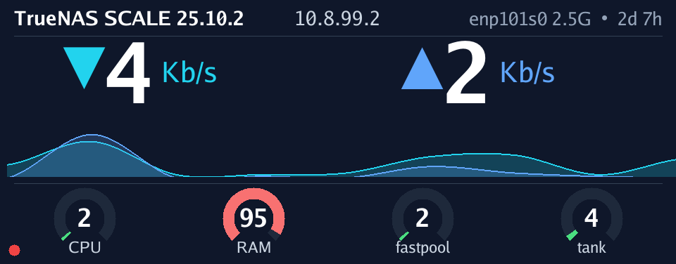

# WTR Display - TrueNAS Network Monitor



A Go application to display TrueNAS system statistics on the WTR MAX / AOOSTAR front panel LCD display.

> **Note**: This project is specifically built for **TrueNAS SCALE** running on AOOSTAR WTR MAX hardware. It's tailored to my personal use case. If you need different features or want to adapt it for other systems, please fork this repository.

## Acknowledgments

This project was made possible thanks to [zehnm/aoostar-rs](https://github.com/zehnm/aoostar-rs) and their reverse engineering efforts of the AOOSTAR display protocol. Their work documenting the proprietary serial protocol, image format, and control commands enabled this Go implementation. Thank you!

## Features

- **Network Throughput**: Real-time upload/download speeds with animated wave visualization
- **System Information**: TrueNAS version, IP address, interface name, link speed, uptime
- **CPU Usage**: Live CPU utilization with color-coded arc gauge
- **Memory Usage**: RAM utilization percentage with arc gauge
- **ZFS Pool Status**: Auto-discovers pools (boot pools filtered), dynamic gauge sizing for 2-6 items
- **Notifications**: External scripts can send notifications to the display
- **Screenshots**: Capture current display to PNG file
- **Login Indicator**: Red dot shows when users are logged into shell
- **ZFS Maintenance Alerts**: Automatic notifications for scrub, resilver, degraded pools
- **Night Mode**: Schedule display off/on times
- **Auto Mode**: Smart FPS scaling based on activity

## Display Specifications

- **Resolution**: 960 x 376 pixels
- **Connection**: USB UART (VID:PID `0416:90A1`)
- **Protocol**: Proprietary serial protocol with RGB565 image data
- **Device**: Typically `/dev/ttyACM0` on Linux

## Installation

### Install on TrueNAS SCALE (Recommended)

Download the latest release binary and set it up to start automatically on boot.

#### 1. Download the binary

SSH into your TrueNAS box and download the latest release to a persistent dataset:

```bash
mkdir -p /mnt/tank/apps/wtr-display
cd /mnt/tank/apps/wtr-display

# Download the latest release (replace version as needed)
wget https://github.com/lennarkivistik/aoostar-wtr-max-truenas-display/releases/download/v1.0.1/wtr-display-linux-amd64-v1.0.1
chmod +x wtr-display-linux-amd64-v1.0.1
```

> Replace `/mnt/tank/` with your own pool/dataset path. The binary must live on a dataset so it survives reboots and updates.

#### 2. Create a start script

Create `/mnt/tank/apps/wtr-display/start.sh`:

```bash
#!/bin/sh
exec /mnt/tank/apps/wtr-display/wtr-display-linux-amd64-v1.0.1 --iface enp101s0 --auto >/dev/null 2>&1
```

Then make it executable:

```bash
chmod +x /mnt/tank/apps/wtr-display/start.sh
```

> Adjust `--iface` to your network interface. Run `./wtr-display-linux-amd64-v1.0.1 --list-ifaces` to see available interfaces. Don't background the process with `&` -- `exec` replaces the shell cleanly.

#### 3. Add as Init Script in TrueNAS UI

1. Go to **System Settings > Advanced > Init/Shutdown Scripts > Add**
2. Configure:
   - **Type**: Script
   - **Script**: `/mnt/tank/apps/wtr-display/start.sh`
   - **When**: Post Init
   - **Enabled**: Yes
   - **Timeout**: 10 seconds

The display will now start automatically on every boot after networking is up.

### Build from Source

```bash
# Build for Linux x86_64 (TrueNAS)
./build.sh linux amd64 v1.0.1

# Output: build/linux-amd64/wtr-display-linux-amd64-v1.0.1
```

### Deploy Manually

```bash
# Copy binary to TrueNAS
scp build/linux-amd64/wtr-display-linux-amd64-v1.0.1 root@truenas:/mnt/tank/apps/wtr-display/

# On TrueNAS, make executable
chmod +x wtr-display-linux-amd64-v1.0.1
```

## Usage

### Basic Commands

```bash
# Turn display on
./wtr-display --on

# Turn display off
./wtr-display --off

# List available network interfaces
./wtr-display --list-ifaces

# Show version
./wtr-display --version
```

### Monitor Mode (Main Feature)

```bash
# Monitor network interface (auto-detect display)
./wtr-display --iface eth0

# With specific device
./wtr-display --device /dev/ttyACM0 --iface eth0

# With night mode (display off 23:00-10:00)
./wtr-display --iface eth0 --off-time 23:00 --on-time 10:00

# Auto mode (smart FPS + default night mode 23:00-10:00)
./wtr-display --iface eth0 --auto

# Custom animation settings
./wtr-display --iface eth0 --wave-fps 8 --samples 10
```

### Notifications

Send notifications to a running display instance:

```bash
# Info notification (default 10 seconds)
./wtr-display --notify "Backup complete"

# Warning notification (5 seconds)
./wtr-display --notify "Scrub starting" --notify-type warning --notify-duration 5

# Danger notification (persistent until replaced)
./wtr-display --notify "Drive failure!" --notify-type danger --notify-duration 0
```

Or via Unix socket directly:
```bash
echo '{"message":"Hello","theme":"warning","duration":10}' | nc -U /tmp/wtr-display.sock
```

### Screenshots

Capture the current display to a PNG file:

```bash
# Save screenshot from running display
./wtr-display --screenshot /tmp/display.png
```

### All Options

| Flag | Description | Default |
|------|-------------|---------|
| `--device` | Serial device path | Auto-detect |
| `--on` | Turn display on and exit | - |
| `--off` | Turn display off and exit | - |
| `--iface` | Network interface to monitor | - |
| `--list-ifaces` | List available interfaces | - |
| `--version` | Show version | - |
| `--wave-fps` | Animation frames per second | 4 |
| `--samples` | Sparkline history samples | 5 |
| `--frame-interval` | Override update interval (e.g., `500ms`) | - |
| `--auto` | Smart FPS + default night mode | false |
| `--off-time` | Night mode start (HH:MM) | - |
| `--on-time` | Night mode end (HH:MM) | - |
| `--no-cache` | Disable frame caching | false |
| `--notify` | Send notification to running display | - |
| `--notify-type` | Notification type: `info`, `warning`, `danger` | info |
| `--notify-duration` | Notification duration in seconds (0=persistent) | 10 |
| `--screenshot` | Save screenshot from running display (PNG) | - |

## Documentation

- [Design Concepts](docs/DESIGN.md) -- display layout, color coding, gauge design
- [Development Guide](docs/DEVELOPMENT.md) -- architecture, data sources, protocol details, coding conventions

## Requirements

- Linux system with ZFS (for pool monitoring)
- WTR MAX / AOOSTAR device with front panel display
- Go 1.24+ (only for building from source)

## License

[Apache License, Version 2.0](LICENSE)
